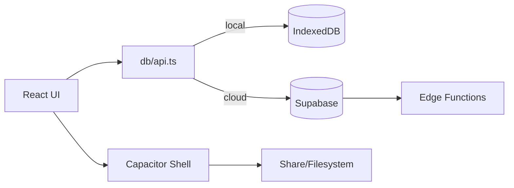

# 01 — Application Architecture

**Audit date:** 2026-11-12

## Stack (verified)

| Layer | Technology | Evidence |
|-------|------------|----------|
| UI | React 18 + TypeScript + Vite 5 + Tailwind | `package.json`, `src/` |
| Routing | React Router 7 in `src/App.tsx` | single BrowserRouter |
| Local data | Dexie 4 IndexedDB `sella_local` | `src/db/localDb.ts` |
| Cloud data | Supabase Postgres + Auth + Storage | `src/db/cloudApi.ts`, `supabase/` |
| Mobile | **Capacitor 8** wrapping `dist/` web build | `capacitor.config.ts`, `android/`, `ios/` |
| PWA | vite-plugin-pwa / Workbox | `vite.config.ts` |
| PDF | jsPDF + autotable | `src/lib/invoicePdf.ts` |
| Sharing | `@capacitor/share` + Filesystem | `src/lib/whatsappReminder.ts` |

**Not** React Native / Expo runtime for shipping (Expo `app.json`/`eas.json` are legacy metadata; primary path is Capacitor).

## Mode switching

`src/db/api.ts` → cloud iff `VITE_DATA_MODE=cloud` **and** valid Supabase URL/anon key (`src/integrations/supabase/client.ts`). Otherwise local Dexie.

## Route map

Public: `/`, `/forgot-password`, `/reset-password`, `/terms`, `/privacy`, `/install`  
AppShell: `/dashboard`, `/debts`, `/sales`, `/inventory`, `/more`, `/assistant`, `/clients`, `/inbox`, `/add-debt`, `/new-sale` (AddDebt POS), `/receipt-settings`, `/account`, `/subscribe`, `/billing`, `/import-customers`, `/admin/payments`

## Critical workflows (UI → DB)

### Sale / credit checkout
`AddDebt.tsx` → `createSaleOrder` (`localApi` transactional / `cloudApi` sequential REST) → inventory decrement → debt + debt_items → sales lines → payments → receipt UI.

### Debt payment
`Debts.tsx` + `PaymentModal` → `recordPayment` → remaining_balance update → sale payment_status.

### WhatsApp reminder
`Debts.tsx` → `runDebtReminderShare` → validate phone → `invoicePdfBlob` → Filesystem cache → `Share.share` (native) / Web Share / wa.me fallback.

### Subscription
`Subscribe.tsx` / `Billing.tsx` → Paypack / manual MoMo+receipt / Apple stub → edge webhooks → `user_subscriptions`.

## Architecture risks

1. Dual-mode complexity (local vs cloud) confuses ops and testing.  
2. Cloud POS lacks Postgres transaction/RPC.  
3. Legacy open-RLS SQL still in migrations history.  
4. Large single JS chunk (~1.33 MB).  
5. Expo + Capacitor dual packaging story can confuse release engineers.

## Diagram

